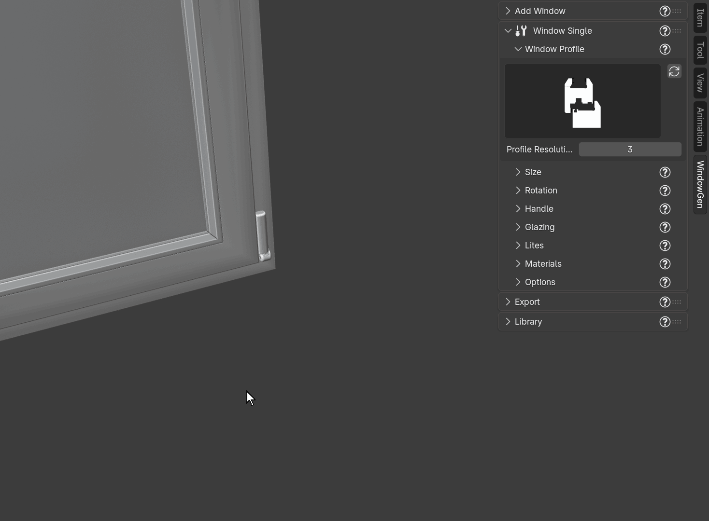
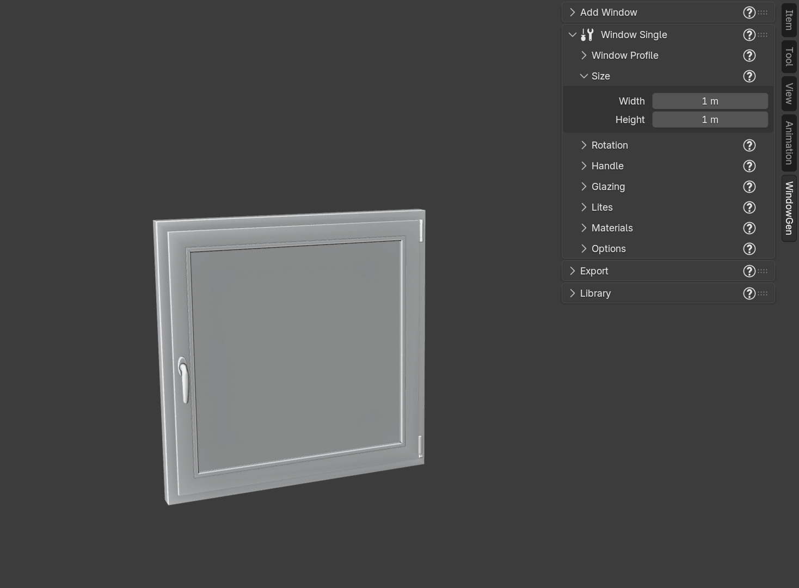
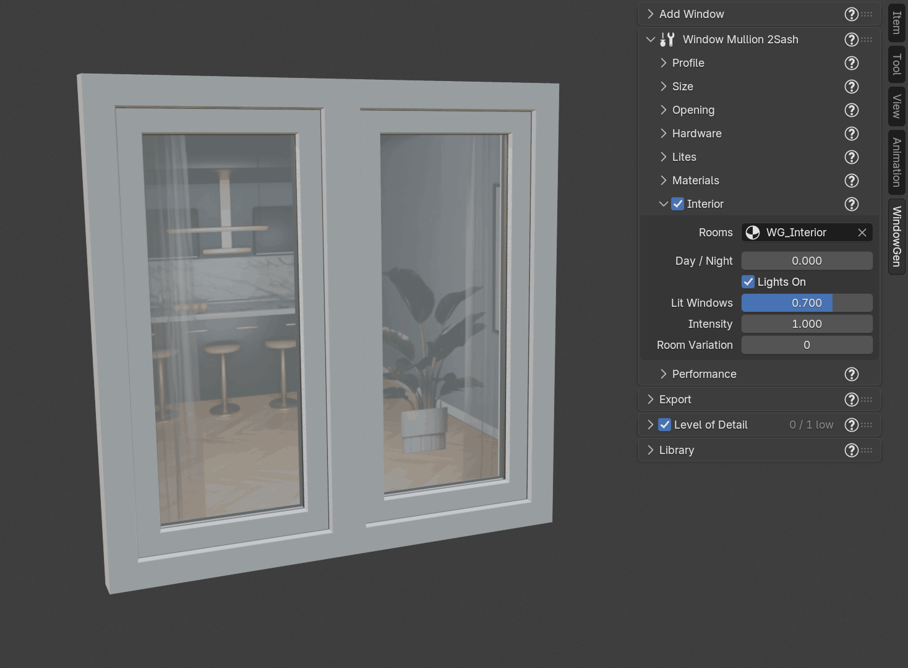
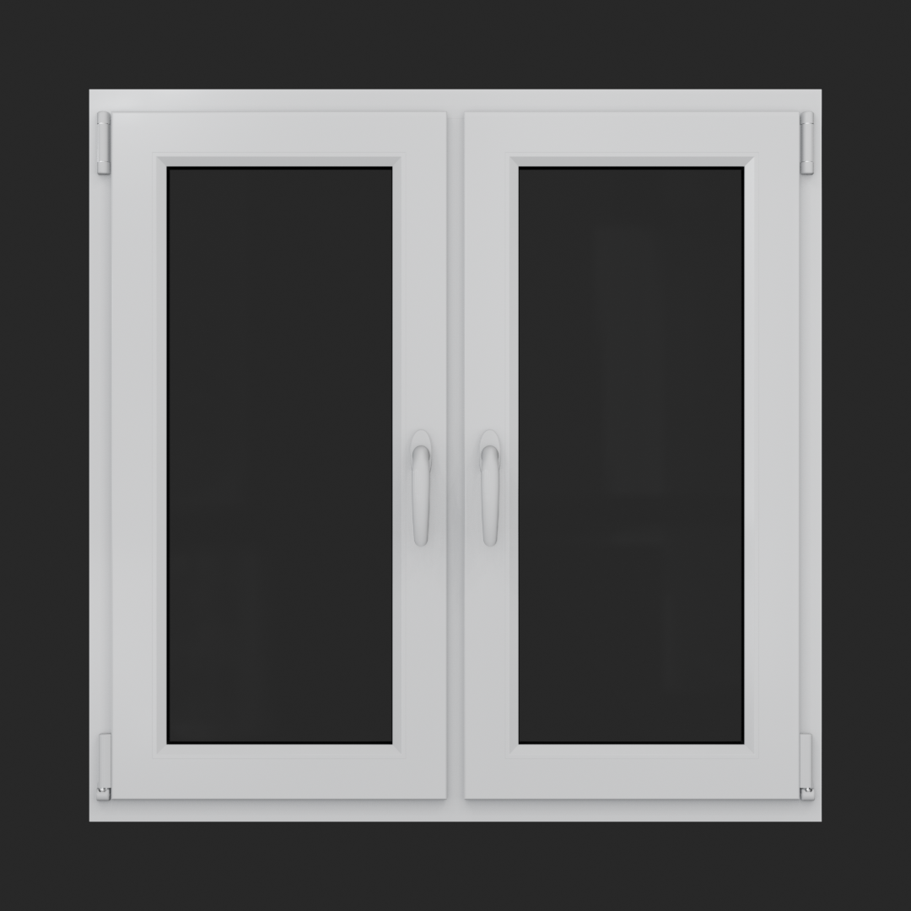
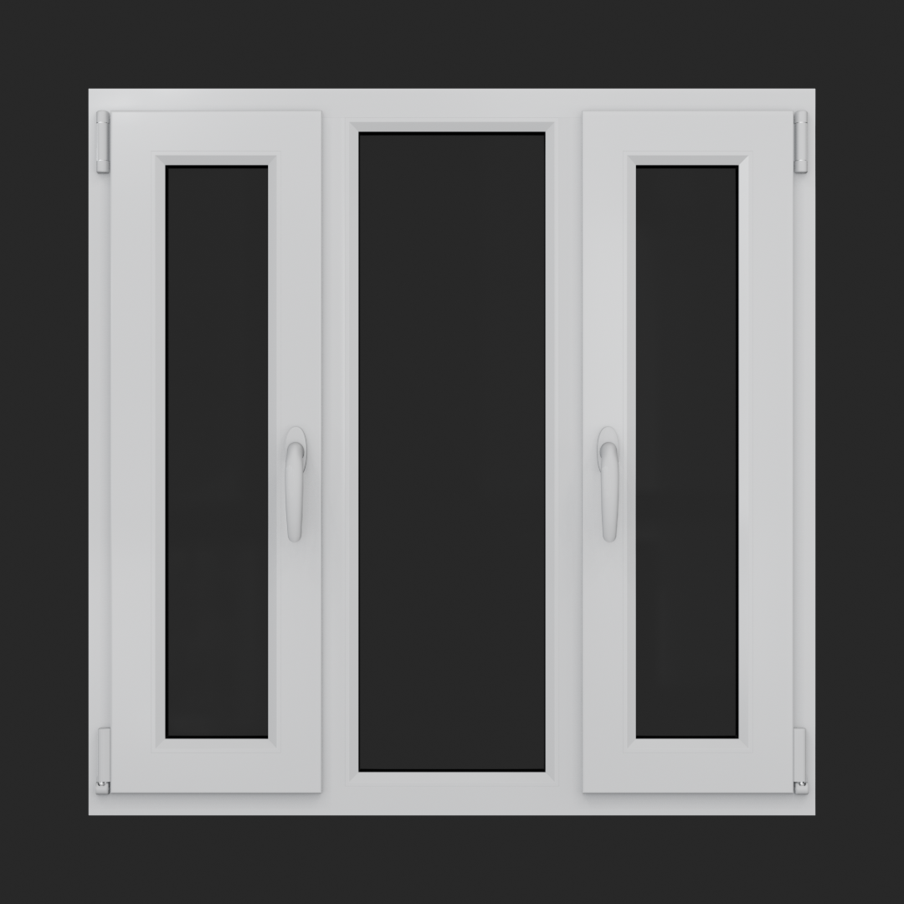
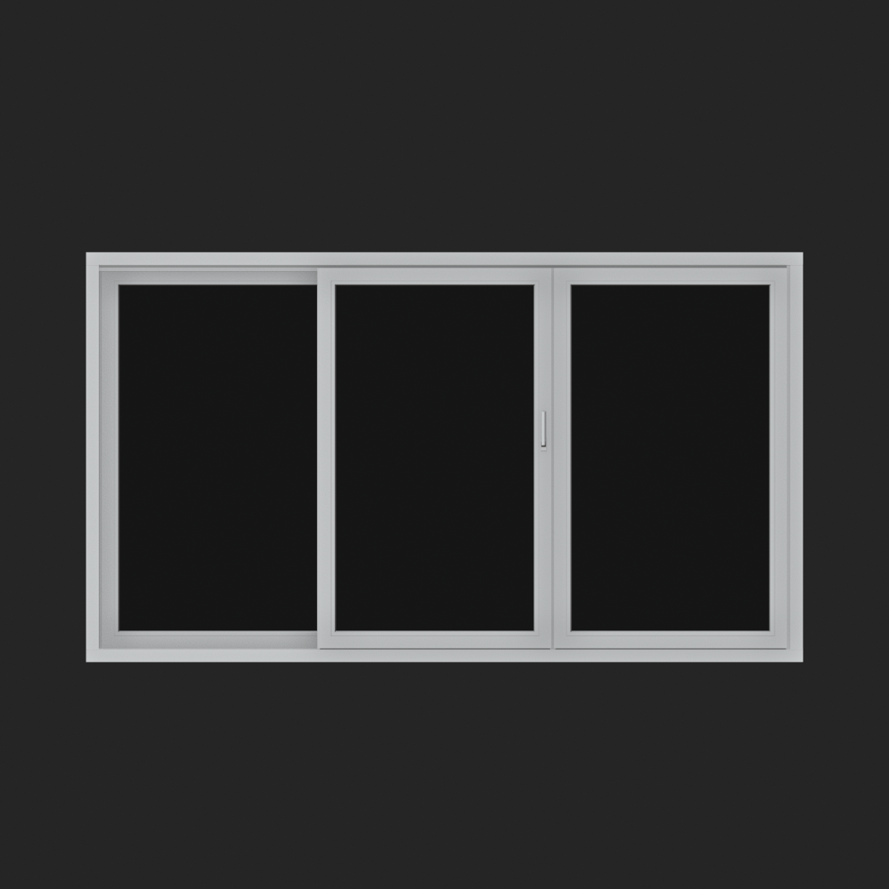
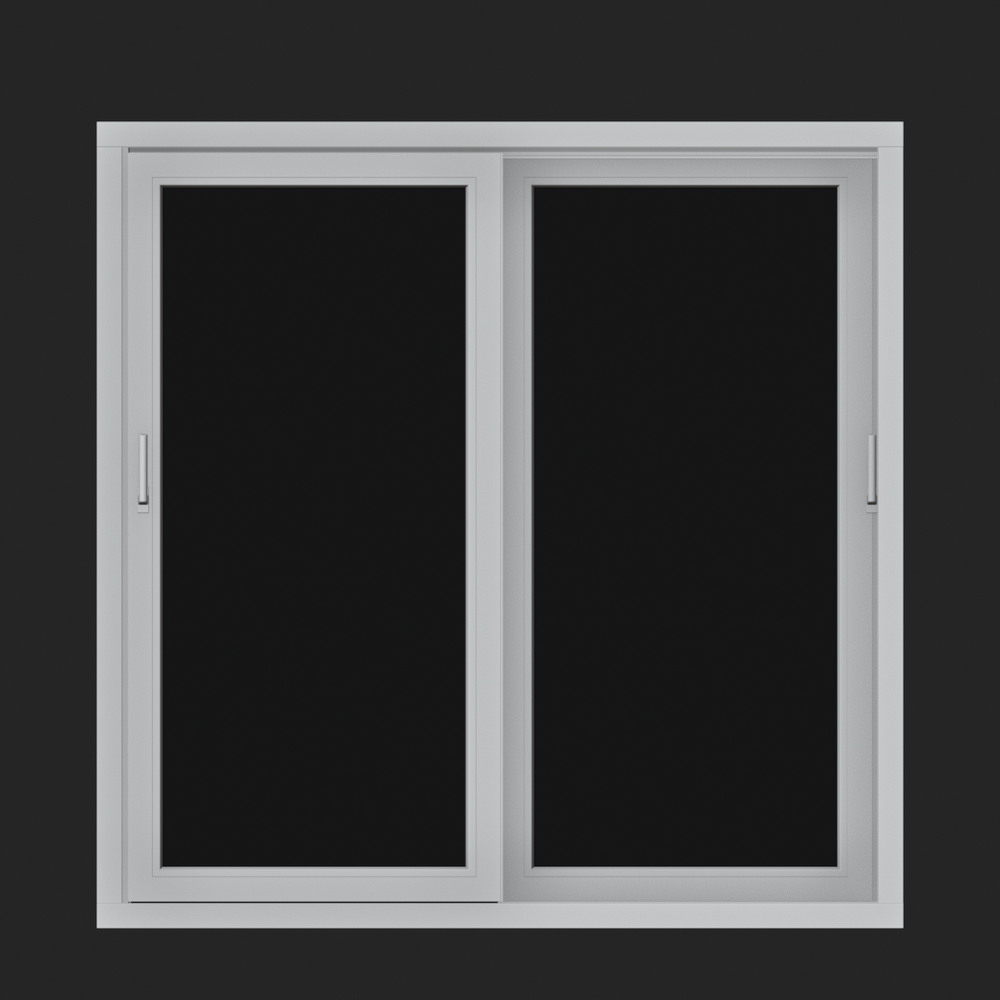
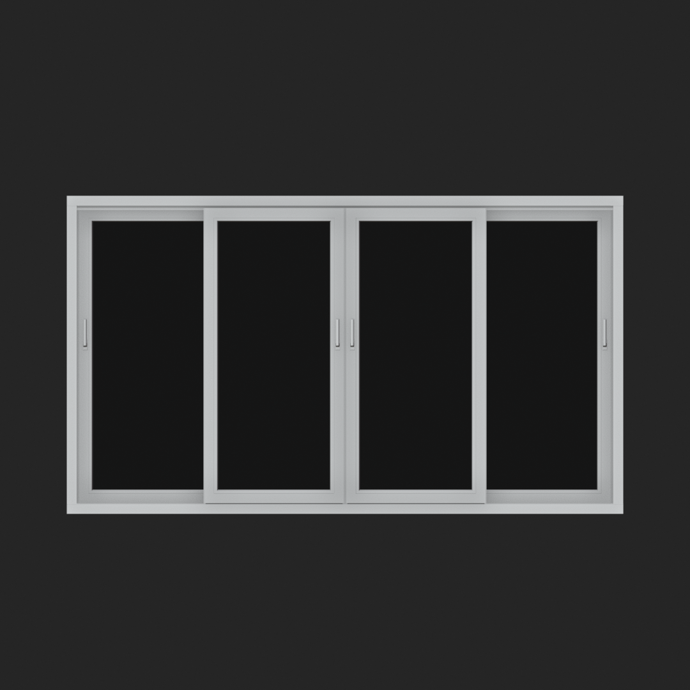
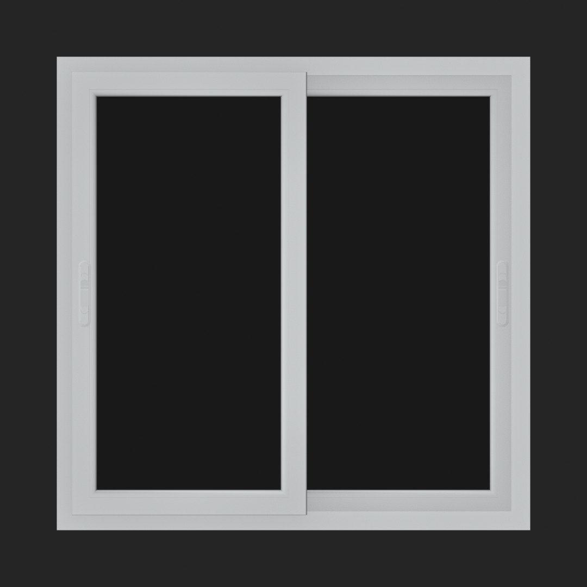

.. _parameters:

Parameters
==========

Select a window to see its parameters in the *WindowGen* tab. The settings panel is titled with the name of the active window, so with several windows in the scene you always know which one you are editing.

.. image:: images/03_parameters_settings.gif
   :width: 75%

Every window keeps its own settings. Changing a handle, a profile or a material on one window never affects another. The one exception is the look of the *Interior* rooms, which belongs to the rooms material and is shared by every window that uses it.

The panels are in this order: *Profile*, *Size*, *Opening*, *Hardware*, *Lites*, *Materials*, *Interior* and *Performance*.

.. note::
    The panels only show what applies to the selected window type. A fixed frame has no *Opening* and no *Hardware* panel, only casement windows have *Lites*, and so on.

Common Parameters
-----------------

These parameters are shared by most window types.

Profile
~~~~~~~

An icon gallery with the built-in profile systems. Click the preview and pick a profile.

Casement windows offer WHS60, WHS72, Euroline58, Softline70 and Softline82. Sliding windows have their own profile systems, see :ref:`sliding-windows`. Portals use a single profile system, so their *Profile* panel has no gallery.

Resolution
    Sets how finely the rounded corners of the profile are subdivided. Lower it for windows far from the camera, raise it for close-ups.

    .. image:: images/03_parameters_profile_resolution.gif
        :width: 75%

    When :ref:`level-of-detail` draws a far window more simply, a line under the field says *Drawn at 1*. Your value is kept and comes back as soon as the window is near the camera again.

Glazing
    Choose between double glazing (two panes, one spacer) and triple glazing (three panes, two spacers). The animation shows the glazing from above.

    .. image:: images/03_parameters_glazing.gif
        :width: 75%

.. note::
    Custom profiles aren't currently supported due to dependencies on specific parameters for hinges, handles, and striker plates. Feel free to contact us for specific profile requests.

.. tip::
    If for some reason there are no previews, press **Reload Previews** in the *Library* panel.

Size
~~~~

Width and height of the window.

Pivot
    Where the object origin sits: at the **Bottom** of the window (the default) or in its **Center**.

    .. image:: images/03_parameters_origin.gif
        :width: 75%

Opening
~~~~~~~

The *Opening* panel controls how the sashes open: turn and tilt on casement windows, slide on portals and sliding windows. It is available for every window that has a moving sash.

Direction
   Choose between inward and outward opening.

   .. image:: images/03_parameters_opening.gif
        :width: 75%

The turn, tilt and slide values depend on the window type and are described for each type below.

.. important::
    The tilt angle is limited by the length of the stay arm, as on a real window. Values above the limit have no further effect.

Hardware
~~~~~~~~

The *Hardware* panel holds everything fitted to the sash: the handle, its position and angle, the hinges and the locks.

Handle
    Choose one of the built-in handles, *No Handle*, or *Custom*.

    .. image:: images/03_parameters_handle.gif
        :width: 75%

Custom Handle
    Use your own handle. Choose *Custom* and assign your objects to *Lever Geometry* and *Backplate*. Refer to :ref:`customization` on how to prepare them.

    .. image:: images/03_parameters_01_handle_cutom.gif
        :width: 75%

Lever Geometry
    The part that you hold and turn to open or close the window.

    .. image:: images/03_parameters_01_handle_lever.png
        :width: 50%

Backplate
    Fixed decorative plate around the base of the handle.

    .. image:: images/03_parameters_01_handle_backplate.png
        :width: 50%

Handle Position
    Choose between *Centered* (the middle of the sash) and *Manual*.

    .. image:: images/03_parameters_handle_position.gif
        :width: 75%

Height
    Shown when *Handle Position* is set to *Manual*. Sets the height of the handle.

    .. image:: images/03_parameters_manual_position.gif
        :width: 75%

Handle Angle
    Sets the rotation of the handle. Windows with two handles show one value for each sash.

    .. image:: images/03_parameters_handle_rotation.gif
        :width: 75%

Hinges
    Shows or hides the hinges. Casement windows only.

    .. image:: images/03_parameters_hinges.gif
        :width: 75%

Locks and Strikers
    Shows or hides the locking hardware: the strikers on the frame and the locks on the sash. The handle stays. Not available for sliding windows.

    .. image:: images/03_parameters_locks.gif
        :width: 75%

.. tip::
    Turn hinges and locks off for windows that are only seen from a distance. :ref:`level-of-detail` can do this by itself for windows far from the camera.

Lites
~~~~~

Lites divide the glass into smaller panes. The panel is available for casement windows.

Horizontal
    Sets the number of horizontal lites.

    .. image:: images/03_parameters_01_lites_h.gif
        :width: 75%

Vertical
    Sets the number of vertical lites.

    .. image:: images/03_parameters_01_lites_v.gif
        :width: 75%

Bar Width
    Sets the width of the lites.

    .. image:: images/03_parameters_01_lites_w.gif
        :width: 75%

Materials
~~~~~~~~~

Assign materials to the parts of the window and control the UV scale.

.. image:: images/03_parameters_material_slots.png
   :width: 50%

Each slot accepts any material in the file. Casement windows have *Hinge* and *Hardware* slots; portals and sliding windows have a *Rail* slot instead.

Texel Density
    Sets the texel density (px/m) for the window. It works together with *Texture Size*.

    .. image:: images/03_parameters_material_texel.gif
        :width: 75%

Texture Size
    Sets the resolution of the texture. Change it to the resolution of the textures your material uses.

    .. image:: images/03_parameters_material_texture.gif
        :width: 75%

.. tip::
    Texel density controls how many texture pixels (texels) cover a meter of geometry. Use this formula:

    .. code-block:: text

        Texel density = texture resolution (px) / physical size (m)

    Example: a 2048 px texture applied to a 2 m width gives a texel density of 1024 px/m.

    Some texture resources (Megascans, Poliigon, Greyscale Gorilla etc.) include physical size of the texture in meters:

    .. image:: images/03_parameters_materials_uv_scale.png
        :width: 50%

.. warning::
    For the materials to work correctly for mapping, choose the **UV Map** node and select UVMap (in some cases, the **Realize Instances** option in the *Performance* panel must be enabled).

    .. image:: images/03_parameters_materials.png
        :width: 75%
        :align: center

.. note::
    - **UVMaps:** The window includes necessary UVMaps, although there may be rotation issues at certain widths due to limitations in controlling UV unwrapping in geometry nodes.
    - **Spacer Material:** If you wish to change the spacer material, it's recommended to adjust the existing material to your needs as it contains a custom bump map for a realistic look and helps to reduce extra geometry for the spacer.

.. _interior:

Interior
~~~~~~~~

Rooms behind the glass, for facades seen from outside. Each window shows a furnished room with depth, walls, floor, ceiling, furniture and curtains, drawn by a single material instead of real geometry, so a building with hundreds of windows stays light. Different windows get different rooms automatically.

Turn the interior on with the checkbox in the panel header. The animations in this section show a facade of nine windows rendered with EEVEE.

Rooms
    The rooms material. WindowGen uses its built-in *WG_Interior* material. If the field is empty, press **Use Built-in Rooms**.

Day / Night
    Blends the rooms from daylight (0) to night (1). It changes only the rooms: in the animation the sky and the sun are dimmed separately, as you would light a night scene.

    .. image:: images/03_parameters_interior_daynight.gif
        :width: 75%

Lights On
    Turns the room lights on or off at night.

    .. image:: images/03_parameters_interior_lights.gif
        :width: 75%

Lit Windows
    The share of rooms with the lights on at night. Available when *Lights On* is on.

    .. image:: images/03_parameters_interior_lit.gif
        :width: 75%

Intensity
    Brightness of the rooms.

    .. image:: images/03_parameters_interior_intensity.gif
        :width: 75%

Room Variation
    Gives every window another room, mirroring and lighting.

    .. image:: images/03_parameters_interior_variation.gif
        :width: 75%

.. important::
    The look settings belong to the rooms material, so they are **shared by every window that uses it**. The panel says how many windows that is, for example *Shared by 48 windows using WG_Interior*. To give a group of windows a different look, assign them a copy of the material.

.. note::
    The rooms are seen from outside. From inside the building the interior is invisible, so it never blocks the view out of a window.

.. _performance:

Performance
~~~~~~~~~~~

Detail
    *Auto* lets :ref:`level-of-detail` decide by the distance to the camera. *Full* always keeps every detail, for hero windows. *Low* always draws the window simpler, for windows that are never seen up close. The line below says whether the window is drawn at low detail right now.

    .. image:: images/03_parameters_detail.gif
        :width: 75%

Realize Instances
    Converts instances into real geometry. Keep it off while you work: the viewport is faster and the file smaller. Turn it on when a material or another modifier needs real geometry. The animation shows the vertex count in the viewport statistics. Shading looks the same either way.

    .. image:: images/03_parameters_instances.gif
        :width: 75%

.. tip::
    To turn a window into a plain mesh, use **Convert to Mesh…** in the *Export* panel, see :ref:`convert-to-mesh`.

Window Single
-------------
 A window featuring a single operable sash that can either tilt or turn.

.. image:: images/03_parameters_06_window.png
   :width: 50%

Opening
~~~~~~~

Direction
    Sets the direction in which the sash opens.

    .. image:: images/03_parameters_06_sash_opening.gif
        :width: 75%

Side
    Sets the side the sash is hinged on.

    .. image:: images/03_parameters_06_swing_side.gif
        :width: 75%

Turn
    Sets the turn angle of the sash.

    .. image:: images/03_parameters_06_sash_turn.gif
        :width: 75%

Tilt
    Sets the tilt angle of the sash.

    .. image:: images/03_parameters_06_sash_tilt.gif
        :width: 75%

Window Single Frame
-------------------
 A window with a fixed, non-opening section. It has no *Opening* and no *Hardware* panel.

.. image:: images/03_parameters_07_window.png
    :width: 50%

Window Mullion 1 Sash
---------------------
 A window featuring a single operable sash alongside a fixed, non-opening section.

.. image:: images/03_parameters_03_window.png
   :width: 50%

Size
~~~~

Mullion Centered
    Divides the window into two equal sections. Turned on by default.

    .. image:: images/03_parameters_03_mullion_centered.gif
        :width: 75%

Section Width
    Sets the width of the fixed section. Shown when *Mullion Centered* is turned off.

    .. image:: images/03_parameters_03_mullion_width.gif
        :width: 75%

Opening
~~~~~~~

Sash
    Switch the operable sash between the left and the right section.

    .. image:: images/03_parameters_03_left_right.gif
        :width: 75%

Turn
    Sets the turn angle of the sash.

    .. image:: images/03_parameters_03_sash_turn.gif
        :width: 75%

Tilt
    Sets the tilt angle of the sash.

    .. image:: images/03_parameters_03_sash_tilt.gif
        :width: 75%

Window Mullion 2 Sash
---------------------
 A window with two operable sashes that can either tilt or turn.

Opening
~~~~~~~

Right Sash: Turn
    Sets the turn angle of the right sash.

    .. image:: images/03_parameters_04_sash_turn_r.gif
        :width: 75%

Right Sash: Tilt
    Sets the tilt angle of the right sash.

    .. image:: images/03_parameters_04_sash_tilt_r.gif
        :width: 75%

Left Sash: Turn
    Sets the turn angle of the left sash.

    .. image:: images/03_parameters_04_sash_turn_l.gif
        :width: 75%

Left Sash: Tilt
    Sets the tilt angle of the left sash.

    .. image:: images/03_parameters_04_sash_tilt_l.gif
        :width: 75%

The *Hardware* panel of this window has a separate *Handle Angle* for each sash: *Right Sash* and *Left Sash*.

Window Mullion 3 Sash
---------------------
 A window featuring two operable sashes with a fixed, non-opening section in the middle.

Size
~~~~

Mullion Centered
    Divides the window into three equal sections. Turned on by default.

    .. image:: images/03_parameters_05_mullion_centered.gif
        :width: 75%

Section Width
    Sets the width of the outer sections. Shown when *Mullion Centered* is turned off.

    .. image:: images/03_parameters_05_mullion_width.gif
        :width: 75%

Opening
~~~~~~~

Right Sash: Turn
    Sets the turn angle of the right sash.

    .. image:: images/03_parameters_05_sash_turn_r.gif
        :width: 75%

Right Sash: Tilt
    Sets the tilt angle of the right sash.

    .. image:: images/03_parameters_05_sash_tilt_r.gif
        :width: 75%

Left Sash: Turn
    Sets the turn angle of the left sash.

    .. image:: images/03_parameters_05_sash_turn_l.gif
        :width: 75%

Left Sash: Tilt
    Sets the tilt angle of the left sash.

    .. image:: images/03_parameters_05_sash_tilt_l.gif
        :width: 75%

Window Stulp
------------
 A window with two sashes featuring a large, unobstructed opening without a central mullion.

.. image:: images/03_parameters_08_window.png
   :width: 50%

Opening
~~~~~~~

Leading Sash
    Sets which sash carries the handle and opens first.

    .. image:: images/03_parameters_08_left_right.gif
        :width: 75%

Right Sash: Turn
    Sets the turn angle of the right sash.

    .. image:: images/03_parameters_08_sash_turn_r.gif
        :width: 75%

Right Sash: Tilt
    Sets the tilt angle of the right sash.

    .. image:: images/03_parameters_08_sash_tilt_r.gif
        :width: 75%

Left Sash: Turn
    Sets the turn angle of the left sash.

    .. image:: images/03_parameters_08_sash_turn_l.gif
        :width: 75%

Left Sash: Tilt
    Sets the tilt angle of the left sash.

    .. image:: images/03_parameters_08_sash_tilt_l.gif
        :width: 75%

Window Awning
-------------
 A top-hinged window that swings outward from the bottom.

.. image:: images/03_parameters_01_window.png
   :width: 50%

Opening
~~~~~~~

Tilt
    Sets the tilt angle of the sash.

    .. image:: images/03_parameters_01_sash_tilt.gif
        :width: 75%

Window Hopper
-------------
 A bottom-hinged window that tilts inward from the top.

.. image:: images/03_parameters_02_window.png
   :width: 50%

Opening
~~~~~~~

Tilt
    Sets the tilt angle of the sash.

    .. image:: images/03_parameters_02_sash_tilt.gif
        :width: 75%

.. _portal-windows:

Portal Windows
--------------
 Lift and slide doors. Seven schemes are available; the letter follows the usual naming of lift-and-slide schemes.

.. list-table::
   :widths: 20 80
   :header-rows: 1

   * - Preset
     - Layout
   * - Portal A
     - One sliding sash and one fixed section.
   * - Portal C
     - One sliding sash in the middle of two fixed sections.
   * - Portal C4
     - Two sliding sashes that meet in the middle, with a fixed section on each side.
   * - Portal D
     - Two sliding sashes, each with its own handle.
   * - Portal F
     - Four sliding sashes.
   * - Portal K
     - Two sliding sashes at the sides of a fixed middle section.
   * - Portal K4
     - Two sliding sashes at the sides, with the middle divided into fixed sections.

.. image:: images/03_parameters_11_window.png
   :width: 24%

.. image:: images/03_parameters_13_window.png
   :width: 24%

.. image:: images/03_parameters_16_window.png
   :width: 24%
.. image:: images/03_parameters_17_window.png
   :width: 24%

*Top row: Portal A, C, C4, D. Bottom row: Portal F, K, K4.*

Portals share *Profile*, *Size*, *Materials*, *Interior* and *Performance* with the other windows. Their *Opening* panel slides the sashes, and their *Hardware* panel offers the portal handles.

Size
~~~~

Mullion Centered
    Available for Portal A and Portal K. Turn it off to set the width of the fixed section with *Section Width*.

    .. image:: images/03_parameters_10_mullion.gif
        :width: 75%

Opening
~~~~~~~

Slide
    Slides the sash along its track. 0 is closed, 1 is fully open.

    .. image:: images/03_parameters_10_slide.gif
        :width: 75%

Sash
    Available for Portal A, C and D. Sets the side the sliding sash closes on.

    .. image:: images/03_parameters_10_sash_position.gif
        :width: 75%

Left Slide, Right Slide
    Schemes with two sliding sashes (C4, D, K, K4) have one value for each sash.

    .. image:: images/03_parameters_10_slide_two.gif
        :width: 75%

Left, Mid Left, Mid Right and Right
    Portal F has one value for each of its four sashes.

    .. image:: images/03_parameters_10_slide_four.gif
        :width: 75%

Hardware
~~~~~~~~

Handle
    Choose one of the portal handles, *No Handle*, or *Custom*. With *Custom* you assign your own *Lever Geometry*, *Backplate* and *Pull Geometry*.

    .. image:: images/03_parameters_10_handle.gif
        :width: 75%

Handle Position
    *Fixed* places the handle 1 m above the floor, *Centered* in the middle of the sash, and *Manual* at the height set with *Height*.

    .. image:: images/03_parameters_10_handle_position.gif
        :width: 75%

Height
    Shown when *Handle Position* is set to *Manual*. Sets the height of the handle.

    .. image:: images/03_parameters_10_handle_manual.gif
        :width: 75%

Handle Angle
    Sets the rotation of the handle. Schemes with several sliding sashes have one value for each handle (*Left*, *Right* and so on).

Locks and Strikers
    Shows or hides the locking hardware, as on casement windows.

    .. image:: images/03_parameters_10_handle_rotation.gif
        :width: 75%

.. _sliding-windows:

Sliding Windows
---------------
 Lightweight sliding windows on two or three rails.

.. list-table::
   :widths: 30 70
   :header-rows: 1

   * - Preset
     - Layout
   * - Sliding Double
     - Two sashes on two rails.
   * - Sliding Double + Mesh
     - Two sashes on two rails and a sliding mosquito screen.
   * - Sliding Mullion
     - One sliding sash next to a fixed section.
   * - Sliding Triple
     - Three sashes on three rails.

.. image:: images/03_parameters_22_window.png
   :width: 24%
.. image:: images/03_parameters_23_window.png
   :width: 24%
.. image:: images/03_parameters_24_window.png
   :width: 24%

*From left to right: Sliding Double, Sliding Double + Mesh, Sliding Mullion, Sliding Triple.*

Profile
~~~~~~~

Sliding windows have their own profile systems (SL44, SL50, SL60, SL64). The gallery shows the ones available for the selected window type.

.. image:: images/03_parameters_20_profile.gif
   :width: 75%

Opening
~~~~~~~

Front Slide, Back Slide
    Slides each sash along its rail. 0 is closed, 1 is fully open.

    .. image:: images/03_parameters_20_slide.gif
        :width: 75%

Sash
    Swaps the front and back sashes.

    .. image:: images/03_parameters_20_sash_position.gif
        :width: 75%

Middle Slide
    Sliding Triple has a third value for the sash on the middle rail.

    .. image:: images/03_parameters_20_slide_triple.gif
        :width: 75%

Slide
    Sliding Mullion has a single sliding sash.

    .. image:: images/03_parameters_20_slide_mullion.gif
        :width: 75%

Mosquito Slide
    Sliding Double + Mesh has a mosquito screen on its own rail. The animation shows the window from outside.

    .. image:: images/03_parameters_20_mosquito.gif
        :width: 75%

Hardware
~~~~~~~~

Handle
    Choose one of the sliding handles, *No Handle*, or *Custom* with your own *Pull Handle* object.

    .. image:: images/03_parameters_20_handle.gif
        :width: 75%

Glazing
~~~~~~~

Glazing
    In the *Profile* panel. With the SL60 profile, choose between single and double glazing. SL44, SL50 and SL64 are built with fixed glazing, so the choice is greyed out for them. The animation shows the glazing from above.

    .. image:: images/03_parameters_20_glazing.gif
        :width: 75%
