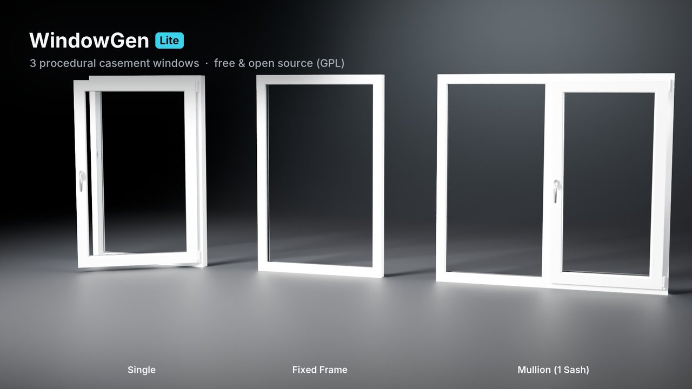

WindowGen Lite
==============

**WindowGen Lite** is the free, open-source edition of WindowGen, distributed through `extensions.blender.org <https://extensions.blender.org/>`_ under the **GNU GPL-3.0-or-later** license. It runs on **Blender 4.2 LTS through 5.3** on Windows, macOS and Linux.

WindowGen Lite creates procedural architectural PVC windows with a real profile cross-section and automatic UVs. Windows are stored in your file, so scenes stay self-contained.

What is included
----------------

- Three procedural casement window types: **Single**, **Fixed Frame** and **Mullion (1 Sash)**.
- One real 70 mm PVC profile cross-section with gaskets, glazing bead and spacer.
- One standard casement handle, or *No Handle*.
- Placement at the **World** origin, at the 3D **Cursor**, or on the active **Face** in Edit Mode, with an optional *Cut Opening*.
- Per-window settings: width and height, turn and tilt opening of the sash, hinge side, inward or outward opening, double or triple glazing, lites (glazing bars), material slots and automatic procedural UVs with *Texel Density* control.
- **Convert to Mesh** for plain geometry when you need it.

Installation
------------

There are two ways to install WindowGen Lite:

1. **From Blender (recommended, Blender 4.2 and newer):** open **Edit > Preferences > Get Extensions**, search for *WindowGen Lite* and press **Install**.
2. **From a zip file:** drag ``windowgen_lite-1.0.0.zip`` from your file manager into the Blender window and confirm the installation. Do not unpack the archive.

Quick start
-----------

1. Press **N** in the 3D Viewport to open the side panel and select the *WindowGen Lite* tab.
2. Choose a placement: **World**, **Cursor** or **Face**. For **Face**, enter Edit Mode on your wall, select the face where the window should go and keep *Cut Opening* on to remove the face.
3. Pick a window type (*Single*, *Fixed Frame* or *Mullion, 1 Sash*) and press **Add Window**. Then adjust size, opening, handle, glazing, lites and materials in the panels below. All of these settings can be changed later and keyframed.

Support and troubleshooting
---------------------------

Frequently asked questions
~~~~~~~~~~~~~~~~~~~~~~~~~~

Q: I selected several faces, but only one window was created.
^^^^^^^^^^^^^^^^^^^^^^^^^^^^^^^^^^^^^^^^^^^^^^^^^^^^^^^^^^^^^

WindowGen Lite places one window on the **active face**, the face you selected last. If no face is selected, the panel reports an error. Placing a window on every selected face in one click, with random window types and seed, is a feature of the full edition, WindowGen 4.1.

Q: Which Blender versions are supported?
^^^^^^^^^^^^^^^^^^^^^^^^^^^^^^^^^^^^^^^^

Blender **4.2 LTS and newer**, tested up to **Blender 5.3**, on Windows, macOS and Linux. Windows render in both Cycles and EEVEE.

Q: Can WindowGen Lite and WindowGen 4.1 be installed at the same time?
^^^^^^^^^^^^^^^^^^^^^^^^^^^^^^^^^^^^^^^^^^^^^^^^^^^^^^^^^^^^^^^^^^^^^^

Yes. WindowGen Lite is a separate extension (``windowgen_lite``) with its own sidebar tab, *WindowGen Lite*, so both can be enabled together without conflicts. When you open a file with Lite windows in WindowGen 4.1, press **Update WindowGen in This File** to switch them to the full components; the windows keep their settings.

Q: Can I send my scene to a render farm or another computer?
^^^^^^^^^^^^^^^^^^^^^^^^^^^^^^^^^^^^^^^^^^^^^^^^^^^^^^^^^^^^

Yes. Windows are appended into your ``.blend`` file, never linked to an external library. The file opens and renders on any machine, with or without WindowGen Lite installed.

Q: How do I update or remove WindowGen Lite?
^^^^^^^^^^^^^^^^^^^^^^^^^^^^^^^^^^^^^^^^^^^^

Open **Edit > Preferences > Get Extensions**. Updates and the uninstall option are listed under *Installed*.

Reporting a bug
~~~~~~~~~~~~~~~

.. note::
    To report a bug or ask for help, write to i@mshevchenko.ru. Please include:

    1. Your Blender version (for example *4.2.23 LTS* or *5.3.0*) and WindowGen Lite version (for example *1.0.0*).
    2. Your operating system: Windows, macOS or Linux.
    3. Short steps to reproduce the problem and any error message. On Windows, open the console with **Window > Toggle System Console**; on macOS and Linux, start Blender from a terminal and copy its output.

License
~~~~~~~

WindowGen Lite, both the Python code and the bundled assets, is licensed under the **GNU GPL-3.0-or-later**.

WindowGen Lite and WindowGen 4.1
--------------------------------

.. list-table::
    :header-rows: 1
    :widths: 22 34 44

    * - Feature
      - WindowGen Lite (free)
      - WindowGen 4.1 (full edition)
    * - Window types
      - 3 casement types: Single, Fixed Frame, Mullion (1 Sash)
      - 19 types: 8 casement (including French/Stulp, Awning and Hopper), 7 portal lift & slide, 4 sliding
    * - Profile systems
      - 1 architectural 70 mm PVC profile
      - 9 real profile systems: 5 casement and 4 sliding rail systems
    * - Handles and hardware
      - 1 standard handle or No Handle
      - 14 real handles for casement, portal and sliding windows, plus your own custom 3D handle
    * - Edit Mode placement
      - Active face, with Cut Opening
      - Every selected face in one click (whole facades), with Random Type and Seed
    * - Batch editing
      - Active window only
      - Edit All Selected, Copy Active, randomize types, sides and opening angles
    * - Parallax interiors (new in 4.1)
      - —
      - One-click rooms behind the glass with almost no extra geometry, in Cycles and EEVEE, with Day / Night, Lights On and Lit Windows controls
    * - Level of Detail (new in 4.1)
      - —
      - Auto, Full and Low detail; up to 87% fewer triangles on distant windows
    * - Game and configurator export
      - Manual Blender export
      - One-click **Prepare for Export** with true hinge pivots (FBX, OBJ, glTF, GLB)
    * - Materials and studio pipeline
      - Built-in default materials
      - Material asset library and a shared studio library folder (``WINDOWGEN_LIBRARY``)
    * - Blender 4.0 and 4.1
      - Blender 4.2 and newer only
      - WindowGen 3.0.3 for Blender 4.0–4.1 is included alongside 4.1 (Blender 4.2–5.3)
    * - License and pricing
      - Free (GNU GPL-3.0-or-later)
      - Solo $29 (1 seat), Team $99 (up to 5 seats), Studio $249 (up to 15 seats). GPL-3.0 code with a seat-based Commercial Asset License

Upgrading to WindowGen 4.1
--------------------------

The full edition is useful when you fill whole facades in one click, render dusk or night scenes with lit interiors, keep large scenes light with Level of Detail, apply client revisions to many windows at once, export windows with real hinge pivots to game engines and configurators, or deploy WindowGen to several seats in a studio. The rest of this documentation describes the full edition.

If you already own WindowGen, version 4.1 is a free update in your Gumroad or Superhive library.

- `WindowGen on Gumroad <https://fetometo.gumroad.com/l/WindowGen>`_
- `WindowGen on Superhive Market <https://superhivemarket.com/products/windowgen>`_

*Dual license:* the Python add-on code (``*.py``) is licensed under GNU GPL-3.0-or-later; the bundled 3D profile libraries, hardware meshes, materials and parallax shaders (``assets/``) are licensed per seat under the included Commercial Asset License for commercial ArchViz, VFX, game and configurator projects.
