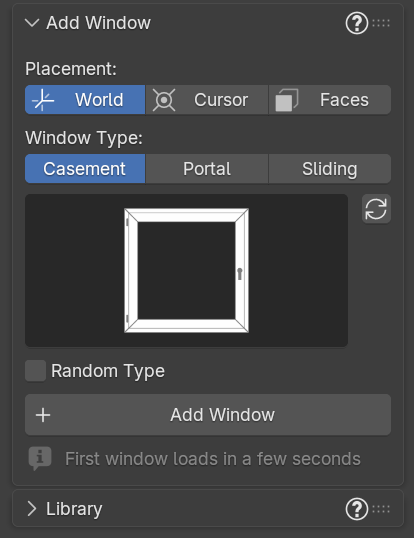
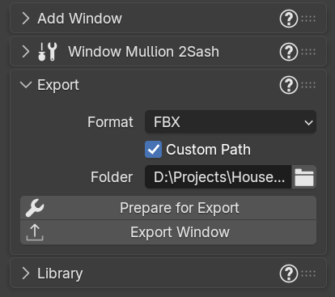

Working With WindowGen
======================

How to open WindowGen interface
-------------------------------

WindowGen is located in the side panel of the 3D Viewport.

1. Press **N** to open the side panel.

    .. important::
        Make sure your mouse cursor is over the 3D View before pressing **N**; otherwise Blender may open a different panel.

2. Select the *WindowGen* tab.

    .. image:: images/01_starting_up_install5.png
        :width: 75%

How to add new window to the scene
----------------------------------

There is no separate "Append WindowGen" step. The components are loaded automatically with the first window you add to a file.

1. Choose where to place the window: at the **World** origin or at the 3D **Cursor**.

    .. image:: images/02_working_with_02origin.gif
        :width: 75%

2. To fit a window into a wall, choose **Face**. Select a face or a closed edge loop in Edit Mode, then add the window. It takes the size and the orientation of the face.

    .. image:: images/02_working_with_02face.gif
        :width: 75%

    .. image:: images/02_working_with_01face.png
        :width: 50%

    *Cut Opening* removes the selected face so the window sits in an opening. Turn it off to keep the face.

    .. note::
        You can press *Add Window* straight from Edit Mode. WindowGen switches back to Object Mode and selects the new window.

3. Choose the window type: Casement, Portal or Sliding.

    .. image:: images/02_working_with_02types.gif
        :width: 75%

4. Click the preview to open the gallery and pick a preset.

    .. image:: images/02_working_with_02pressets.gif
        :width: 75%

5. Press **Add Window**.

    .. image:: images/02_working_with_02select.gif
        :width: 75%

    The first window in a file takes a few seconds while the components are loaded; the mouse cursor and the status bar show that Blender is busy. Every window after that is added instantly.

The new window is selected and its parameters appear below. Navigate to the :ref:`parameters` section to find out how to customize your window.

.. note::
    Only the window itself appears in the Outliner. Profiles, hardware and node groups are stored in the file but are not placed in any scene or collection, so they cannot be moved or deleted by accident. You can see them in the Outliner's *Blender File* view.

Sharing files
-------------

Windows are **appended**, not linked. A .blend file that contains WindowGen windows is self-contained:

- it opens on a computer where WindowGen is not installed, and the windows keep working as geometry nodes objects;
- it does not store the location of the WindowGen library, so nothing has to be relinked when the file is sent to a client, moved to a render farm or opened by a colleague.

WindowGen adds roughly 6 MB to a file, once, no matter how many windows it contains.

How to add WindowGen Asset Library to the Blender
-------------------------------------------------

The WindowGen Asset Library brings realistic materials to customize the appearance of your windows even further.

1. Open the *Library* panel in the WindowGen tab and press **Add WindowGen Material Library**.

    .. image:: images/02_working_with_03add.png
        :width: 50%

2. Once the library is added, the panel shows *Material library added*.

    .. image:: images/02_working_with_03success.png
        :width: 50%

3. Open the Asset Browser and select *WindowGen* in the library list to find the materials.

    .. image:: images/02_working_with_03browser.png
        :width: 75%

    .. tip::
        For easier search most of the materials have tags: Metal, Plastic, RAL color code, etc.

Materials are imported with the *Append* method, so they are copied into your file like the windows are.

Studio setup: one shared library
--------------------------------

By default WindowGen uses the library that is bundled with the add-on. A studio can keep one copy on a network share instead, so every workstation uses the same components and materials.

1. Copy the contents of the add-on's ``assets`` folder to the share. The folder must contain ``WindowGen.blend``, ``windowgen_library.json`` and the ``materials`` folder.

2. On each workstation, open *Edit > Preferences > Add-ons > WindowGen* and set **Library Folder** to that share.

    .. image:: images/02_working_with_03preferences.png
        :width: 75%

    Alternatively, set the environment variable ``WINDOWGEN_LIBRARY`` to the folder. This needs no per-user setup and suits managed deployments. The preference takes priority over the variable.

3. Press **Add WindowGen Material Library** once; the asset library then points at the share as well.

If the folder cannot be reached, WindowGen falls back to the bundled library and says so in the preferences.

.. note::
    Because windows are appended, scenes never contain a path to the library, whether it is local or on the network.

How to update WindowGen
-----------------------

When a file contains components from an older WindowGen version, a notice appears at the top of the *Add Window* panel.

1. Press **Update WindowGen in This File**.

    .. image:: images/02_working_with_04update.png
        :width: 50%

2. All windows are switched to the installed components. Sizes, profiles, handles, materials and every other setting are kept.

    .. image:: images/02_working_with_04success.png
        :width: 50%

The same button converts files made with WindowGen 2 and 3: the link to ``WindowGen.blend``, the hidden *WindowGen Components* scene and the library overrides are removed and replaced by data stored in the file. See the :doc:`faq` for details.

.. _export:

How to export window using WindowGen
------------------------------------

Open the *Export* panel with a window selected.

1. Select the format: FBX, OBJ, glTF or GLB.

2. Select the export location.

    .. note::
        By default WindowGen exports to the folder ``WindowGen_Export``, created next to your .blend file. Enable *Custom Path* to choose another folder.

3. Choose one of the two actions.

    **Prepare for Export (recommended for inspection)**

    Creates an export copy of the window in the *WindowGen Export* collection and leaves the original untouched.

    .. image:: images/02_working_with_05prepare.gif
        :width: 75%

    The copy is a plain mesh, split into logical parts:

    - the **frame**;
    - each **sash** (``sash1``, ``sash2``, ...). Hinged sashes have their origin on the hinge: rotate around Z to turn and around X to tilt. Sliding sashes, portal sashes and the mosquito screen have their origin at the bottom center;
    - each **handle** (``sash1_handle``, ...), parented to its sash, with its origin on the handle axis;
    - a parent **empty** that carries the position, rotation and scale of the window.

    Sash-side hinges and hardware belong to the sash, so they move with it.

    .. image:: images/02_working_with_05origin.gif
        :width: 75%

    .. image:: images/02_working_with_05outliner.png
        :width: 75%

    Unused material slots and helper attributes are removed. You can now inspect the parts, adjust them and export them yourself with *File > Export*.

    **Export Window (one-click export)**

    Does the same and writes the file immediately in the chosen format and location. Smoothing is applied on export.
