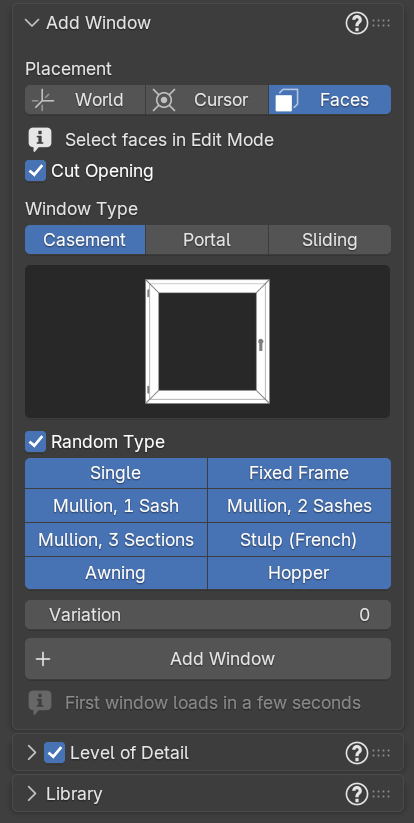
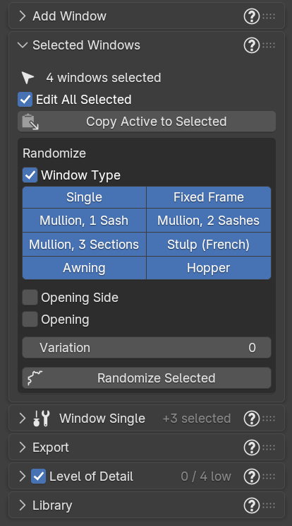
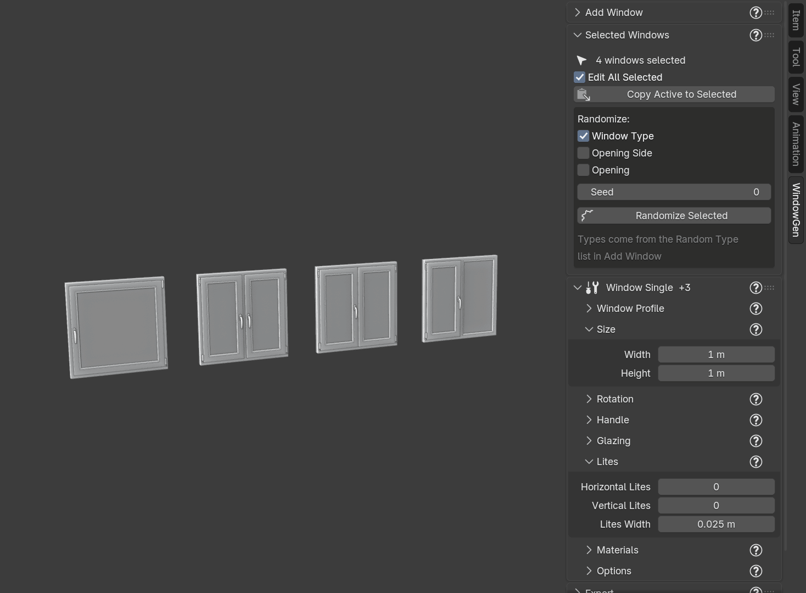
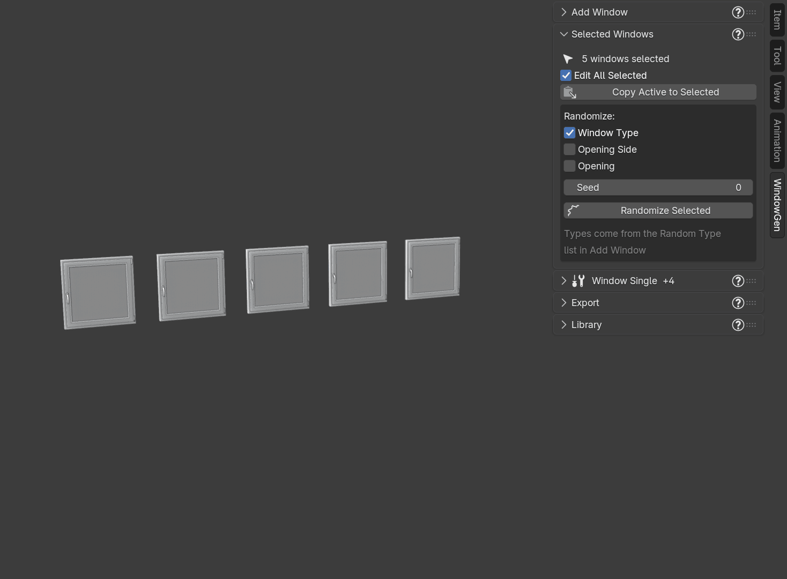
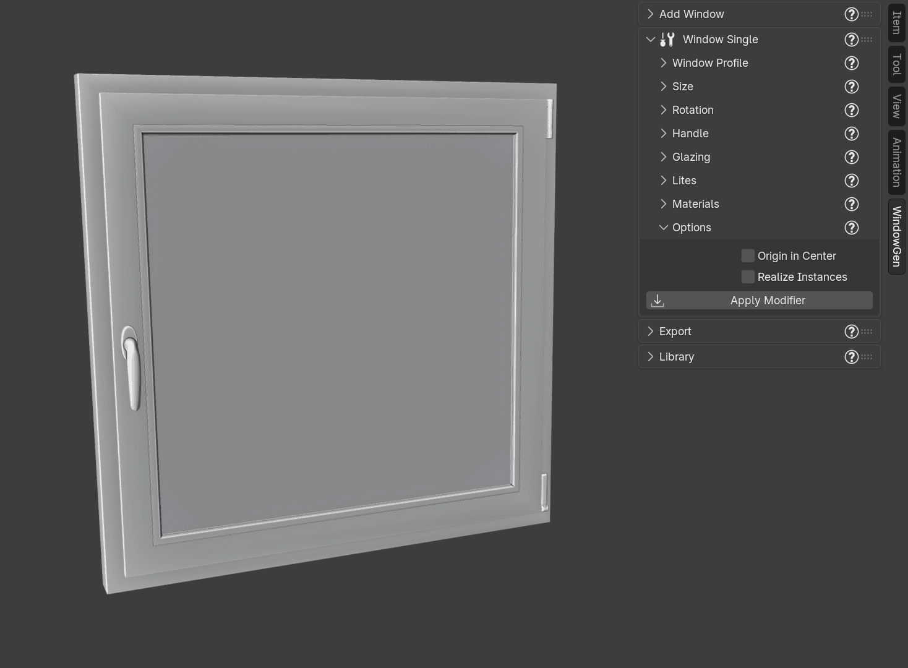
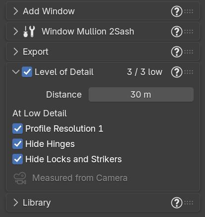

Working With WindowGen
======================

How to open WindowGen interface
-------------------------------

WindowGen is located in the side panel of the 3D Viewport.

1. Press **N** to open the side panel.

    .. important::
        Make sure your mouse cursor is over the 3D View before pressing **N**; otherwise Blender may open a different panel.

2. Select the *WindowGen* tab.

    .. image:: images/01_starting_up_install5.png
        :width: 75%

How to add new window to the scene
----------------------------------

There is no separate "Append WindowGen" step. The components are loaded automatically with the first window you add to a file.

.. image:: images/02_working_with_01add.png
    :width: 50%

1. Choose where to place the window: at the **World** origin or at the 3D **Cursor**.

    .. image:: images/02_working_with_02origin.gif
        :width: 75%

2. To fit a window into a wall, choose **Faces**. Select a face or a closed edge loop in Edit Mode, then add the window. It takes the size and the orientation of the face.

    .. image:: images/02_working_with_02face.gif
        :width: 75%

    .. image:: images/02_working_with_01face.png
        :width: 50%

    *Cut Opening* removes the selected face so the window sits in an opening. Turn it off to keep the face.

    .. note::
        You can press *Add Window* straight from Edit Mode. WindowGen switches back to Object Mode and selects the new window.

    .. tip::
        Select several faces and every one of them gets a window. See :ref:`many-windows`.

3. Choose the window type: Casement, Portal or Sliding.

    .. image:: images/02_working_with_02types.gif
        :width: 75%

4. Click the preview to open the gallery, then click a preset to choose it.

    .. image:: images/02_working_with_02pressets.gif
        :width: 75%

5. Press **Add Window**.

    .. image:: images/02_working_with_02select.gif
        :width: 75%

    The first window in a file takes a few seconds while the components are loaded; the mouse cursor and the status bar show that Blender is busy. Every window after that is added instantly.

The new window is selected and its parameters appear below. Navigate to the :ref:`parameters` section to find out how to customize your window.

.. note::
    Only the window itself appears in the Outliner. Profiles, hardware and node groups are stored in the file but are not placed in any scene or collection, so they cannot be moved or deleted by accident. You can see them in the Outliner's *Blender File* view.

.. _many-windows:

How to work with many windows
-----------------------------

A facade can hold dozens or hundreds of windows. WindowGen places them in one step and lets you adjust them together, so you never have to repeat the same change window by window.

Add a window to every selected face
~~~~~~~~~~~~~~~~~~~~~~~~~~~~~~~~~~~

1. Set *Placement* to **Faces**.
2. In Edit Mode select all the faces that should become windows. The panel shows how many faces are selected, and the button changes to *Add N Windows*. The faces may belong to several objects that are in Edit Mode together.
3. Press **Add N Windows**. Each face gets its own window with the size and the orientation of that face.

    .. image:: images/02_working_with_06faces.gif
        :width: 75%

    .. tip::
        Use Face select mode (press **3** in Edit Mode). In Vertex select mode Blender also selects a face that lies between two selected faces.

Add variety with Random Type
~~~~~~~~~~~~~~~~~~~~~~~~~~~~

Turn on **Random Type** to give each new window a different type. The category you chose stays the same: a casement facade gets only casement windows, but they are a mix of Single, Fixed Frame, Mullion, Stulp and so on.

- Click the types to choose which ones may be used. All of them are on at first.
- **Variation** changes the result. The same value always gives the same arrangement.

Random Type works with every placement, but it is meant for *Faces* with several faces selected.

Edit all selected windows at once
~~~~~~~~~~~~~~~~~~~~~~~~~~~~~~~~~

Select two or more windows and the **Selected Windows** panel appears.

With **Edit All Selected** turned on, every change you make to the active window is repeated on all the selected windows. The header of the settings shows the name of the active window and how many others follow it, for example *Window Single* with *+3 selected*.

- The windows may be of different types. Each window takes the settings that exist for its type and ignores the rest, so a mixed selection stays valid.
- The type of a window is never changed by editing.
- Only the setting you change is passed on. Everything else that differs between the windows stays different.
- One *Undo* takes the change back on all the windows.

**Copy Active to Selected** gives every selected window all the settings of the active one in a single step: profile, glazing, lites, hardware, materials, opening, interior, pivot and *Realize Instances*. Size is left alone unless you turn on *Size* in the operator panel that appears in the bottom left corner of the 3D Viewport.

Turn **Edit All Selected** off when you want to change only the active window while the others stay selected.

Randomize the selected windows
~~~~~~~~~~~~~~~~~~~~~~~~~~~~~~

*Randomize* adds variety to windows that already exist. Choose what to randomize and press **Randomize Selected**.

- **Window Type**: each window gets a random type from its own category. Tick the types that may be used in the list right below it; with several categories in the selection, each has its own list. Size, materials and the other settings are kept.
- **Opening Side**: swaps the hinge, sash or sliding side where the window type has that choice.
- **Opening**: opens the sashes by a random amount, up to *Max Opening*. Fixed frames stay closed.
- **Variation**: change it to get another result.

Sharing files
-------------

Windows are **appended**, not linked. A .blend file that contains WindowGen windows is self-contained:

- it opens on a computer where WindowGen is not installed, and the windows keep working as geometry nodes objects;
- it does not store the location of the WindowGen library, so nothing has to be relinked when the file is sent to a client, moved to a render farm or opened by a colleague.

WindowGen adds roughly 6 MB to a file, once, no matter how many windows it contains.

How to add WindowGen Asset Library to the Blender
-------------------------------------------------

The WindowGen Asset Library brings realistic materials to customize the appearance of your windows even further.

1. Open the *Library* panel in the WindowGen tab and press **Add WindowGen Material Library**.

    .. image:: images/02_working_with_03add.png
        :width: 50%

2. Once the library is added, the panel shows *Material library added*. The panel also shows where the components come from and whether the file is up to date, and has **Reload Previews** for the galleries.

    .. image:: images/02_working_with_03success.png
        :width: 50%

3. Open the Asset Browser and select *WindowGen* in the library list to find the materials.

    .. image:: images/02_working_with_03browser.png
        :width: 75%

    .. tip::
        For easier search most of the materials have tags: Metal, Plastic, RAL color code, etc.

Materials are imported with the *Append* method, so they are copied into your file like the windows are.

Studio setup: one shared library
--------------------------------

By default WindowGen uses the library that is bundled with the add-on. A studio can keep one copy on a network share instead, so every workstation uses the same components and materials.

1. Copy the contents of the add-on's ``assets`` folder to the share. The folder must contain ``WindowGen.blend``, ``windowgen_library.json`` and the ``materials`` folder.

2. On each workstation, open *Edit > Preferences > Add-ons > WindowGen* and set **Library Folder** to that share.

    .. image:: images/02_working_with_03preferences.png
        :width: 75%

    Alternatively, set the environment variable ``WINDOWGEN_LIBRARY`` to the folder. This needs no per-user setup and suits managed deployments. The preference takes priority over the variable.

3. Press **Add WindowGen Material Library** once; the asset library then points at the share as well.

If the folder cannot be reached, WindowGen falls back to the bundled library and says so in the preferences.

.. note::
    Because windows are appended, scenes never contain a path to the library, whether it is local or on the network.

How to update WindowGen
-----------------------

When a file contains components from an older WindowGen version, a notice appears at the top of the *Add Window* panel. The *Library* panel shows the same button; when the file is current it says *up to date* instead.

1. Press **Update WindowGen in This File**.

    .. image:: images/02_working_with_04update.png
        :width: 50%

2. All windows are switched to the installed components. Sizes, profiles, handles, materials and every other setting are kept.

    .. image:: images/02_working_with_04success.png
        :width: 50%

The same button converts files made with WindowGen 2 and 3: the link to ``WindowGen.blend``, the hidden *WindowGen Components* scene and the library overrides are removed and replaced by data stored in the file. See the :doc:`faq` for details.

.. _export:

How to export window using WindowGen
------------------------------------

Open the *Export* panel with a window selected.

.. image:: images/02_working_with_05export.png
    :width: 50%

1. Select the format: FBX, OBJ, glTF or GLB.

2. Select the export location.

    .. note::
        By default WindowGen exports to the folder ``WindowGen_Export``, created next to your .blend file. Enable *Custom Path* to choose another folder.

3. Choose one of the two actions.

    **Prepare for Export (recommended for inspection)**

    Creates an export copy of the window in the *WindowGen Export* collection and leaves the original untouched.

    .. image:: images/02_working_with_05prepare.gif
        :width: 75%

    The copy is a plain mesh, split into logical parts:

    - the **frame**;
    - each **sash** (``sash1``, ``sash2``, ...). Hinged sashes have their origin on the hinge: rotate around Z to turn and around X to tilt. Sliding sashes, portal sashes and the mosquito screen have their origin at the bottom center;
    - each **handle** (``sash1_handle``, ...), parented to its sash, with its origin on the handle axis;
    - a parent **empty** that carries the position, rotation and scale of the window.

    Sash-side hinges and hardware belong to the sash, so they move with it.

    .. image:: images/02_working_with_05origin.gif
        :width: 75%

    .. image:: images/02_working_with_05outliner.png
        :width: 75%

    Unused material slots and helper attributes are removed. You can now inspect the parts, adjust them and export them yourself with *File > Export*.

    **Export Window (one-click export)**

    Does the same and writes the file immediately in the chosen format and location. Smoothing is applied on export.

    Windows at low detail are always exported at full detail. The rooms of the *Interior* are a material effect and are not exported.

.. _convert-to-mesh:

Convert to Mesh
~~~~~~~~~~~~~~~

**Convert to Mesh…** at the bottom of the *Export* panel turns the window into a plain mesh in place. It is red and asks first, because it cannot be reversed except with *Undo*.

.. warning::
    After converting, the window is no longer parametric: its WindowGen settings, level of detail and interior rooms can no longer be changed. Use it when you need to edit the final geometry by hand. To hand a window over to another program, use the export above instead; it leaves the original window untouched.

.. _level-of-detail:

Level of Detail
---------------

On a large facade most windows are far from the camera, where hinges, locks and finely rounded profiles cannot be seen but still cost memory and viewport speed. *Level of Detail* draws those windows more simply, by itself.

- It is on by default. The checkbox in the header turns it off, and the header shows how many windows are at low detail right now, for example *3 / 48 low*, even while the panel is folded.
- **Distance**: windows farther than this from the scene camera are drawn at low detail.
- **At Low Detail**: choose what low detail does. **Profile Resolution 1** saves the most; **Hide Hinges** and **Hide Locks and Strikers** remove the small parts. Handles always stay.
- The last line names the camera the distance is measured from.

How it stays out of your way:

- The windows are updated when the camera stops moving, not while you drag it, so the viewport stays responsive. Only the windows that cross the distance are rebuilt.
- Windows near the limit do not flicker: a window switches to low detail a little beyond *Distance* and back a little inside it.
- Every frame of an animation and every render is up to date, also from the command line.
- The window's own *Resolution*, *Hinges* and *Locks and Strikers* are never changed. Bring the camera closer, or turn Level of Detail off, and the window is exactly as before.
- Export always uses full detail.

To decide per window, use *Detail* in the window's :ref:`performance` panel: *Full* for hero windows that must always keep every detail, *Low* for windows that should always be simple.

.. tip::
    Interior rooms (:ref:`interior`) cost almost no geometry, so they work well together with low detail on large facades.
